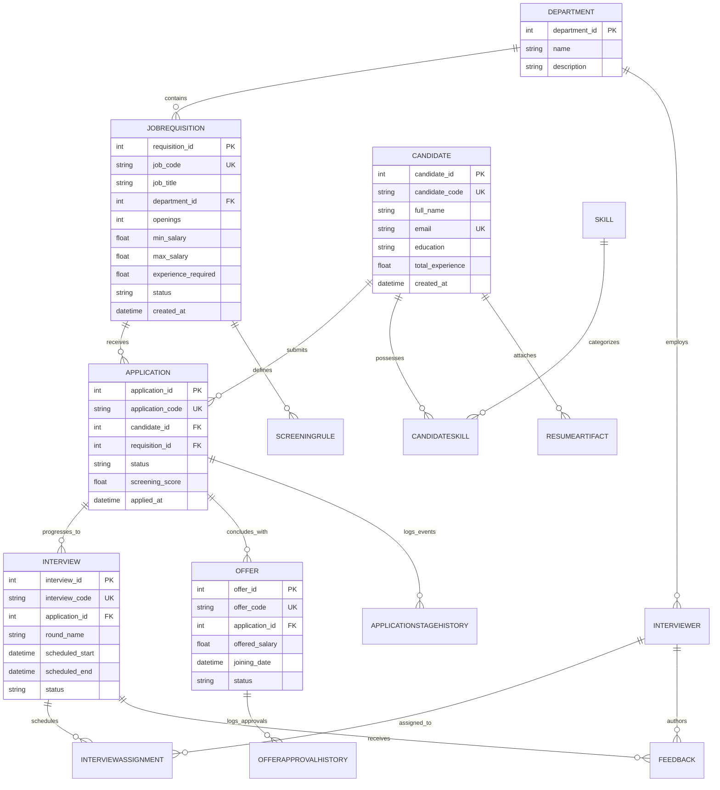
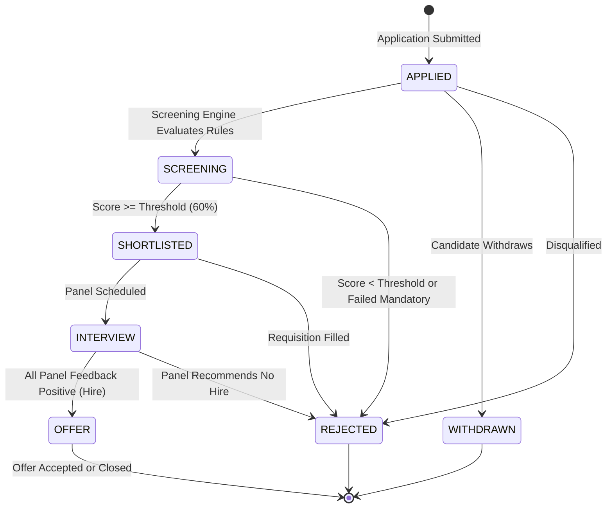
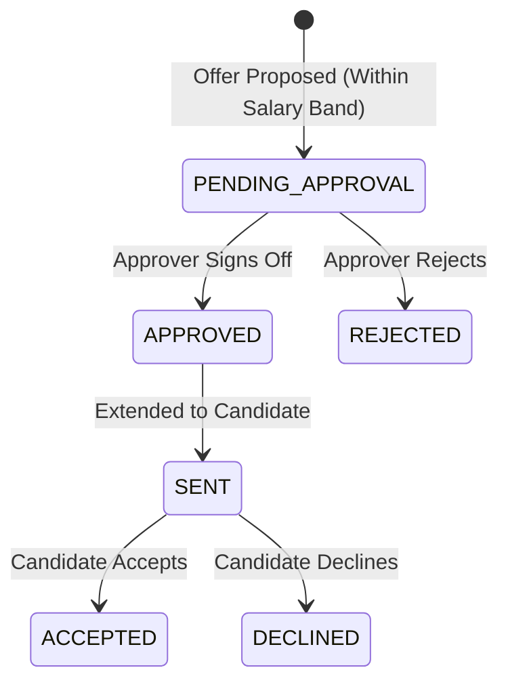

# System Architecture & Technical Specification

## 1. System Overview

The Recruitment Management System (RMS) provides a robust, end-to-end platform for orchestrating enterprise hiring workflows. The system models requisitions, talent profiles, resumes, structured non-demographic screening, interviewer panel scheduling with real-time conflict detection, multi-criteria feedback collection, and offer approvals with salary band compliance enforcement.

---

## 2. Primary Actors & Role-Based Responsibilities

| Actor / System Role | Core Responsibilities | Typical Workflows Owned |
| :--- | :--- | :--- |
| **Business Requester** | Initiates staffing requests, specifies openings and target salary bands. | `POST /requisitions`, Draft Requisitions |
| **Process Owner** | Approves requisitions, defines structured screening rules, oversees interviews. | `POST /screening/rules`, `POST /interviews` |
| **Approver** | Reviews proposed employment offers, validates compensation against band limits. | `POST /offers/{id}/approve` |
| **Operations Analyst** | Tracks funnel metrics, time-to-hire, screening scores, and audits policy anomalies. | `GET /analytics/*`, `GET /exceptions/*` |
| **System Administrator** | Manages master data seeds, reproducibility verification, database migrations. | `POST /system/*`, Data generation |

---

## 3. Entity-Relationship Diagram (ERD)

---

## 4. Application Lifecycle State Machine

---

## 5. Offer Approval State Machine

---

## 6. Policy Rules & Negative Scenarios (Edge Cases)

The architecture exposes policy decisions and retains auditability across 5 specific business exception vectors:

1. **EDGE-01: Interviewer Schedule Conflicts**
   - *Rule*: No interviewer may be assigned to concurrent overlapping interview rounds.
   - *Enforcement*: System calculates `(Start_A < End_B) and (End_A > Start_B)` and throws `409 Conflict`.
2. **EDGE-02: Duplicate Candidate Applications**
   - *Rule*: A candidate may apply only once per job requisition.
   - *Enforcement*: Unique compound constraint on `(candidate_id, requisition_id)` prevents duplicates.
3. **EDGE-03: Missing Feedback with Advanced Stage**
   - *Rule*: Candidate cannot advance to `OFFER` before all assigned panel interviewers submit structured feedback.
   - *Enforcement*: Automated audit service detects applications where `submitted_feedback < expected_feedback`.
4. **EDGE-04: Offer Salary Outside Approved Band**
   - *Rule*: Proposed compensation must reside strictly within `[requisition.min_salary, requisition.max_salary]`.
   - *Enforcement*: `POST /offers` validates salary bounds before persistence; throws `422 Unprocessable Entity` on violation.
5. **EDGE-05: Closed Requisitions with Active In-Flight Applications**
   - *Rule*: When a requisition status transitions to `CLOSED`, no candidate applications may remain in active states (`APPLIED`, `SCREENING`, `SHORTLISTED`, `INTERVIEW`, `OFFER`).
   - *Enforcement*: Audit scanner flags orphaned active applications on closed roles.
